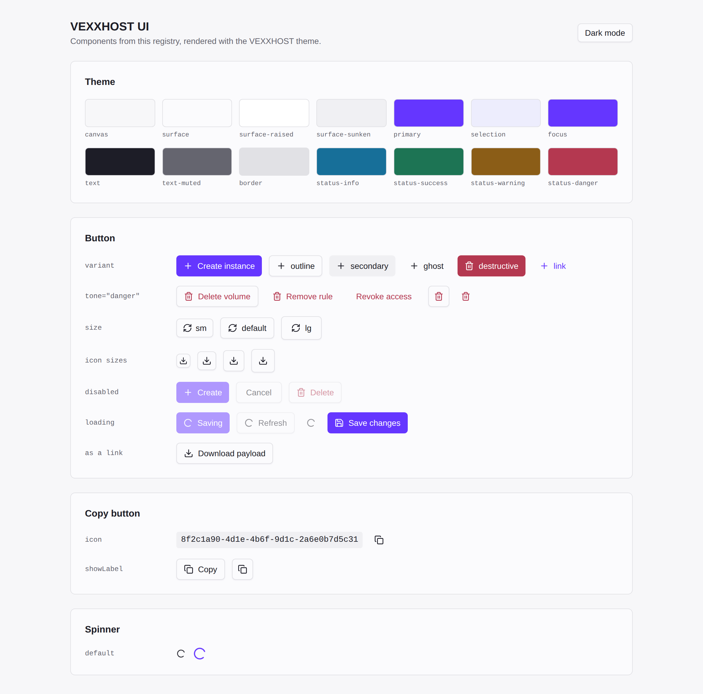
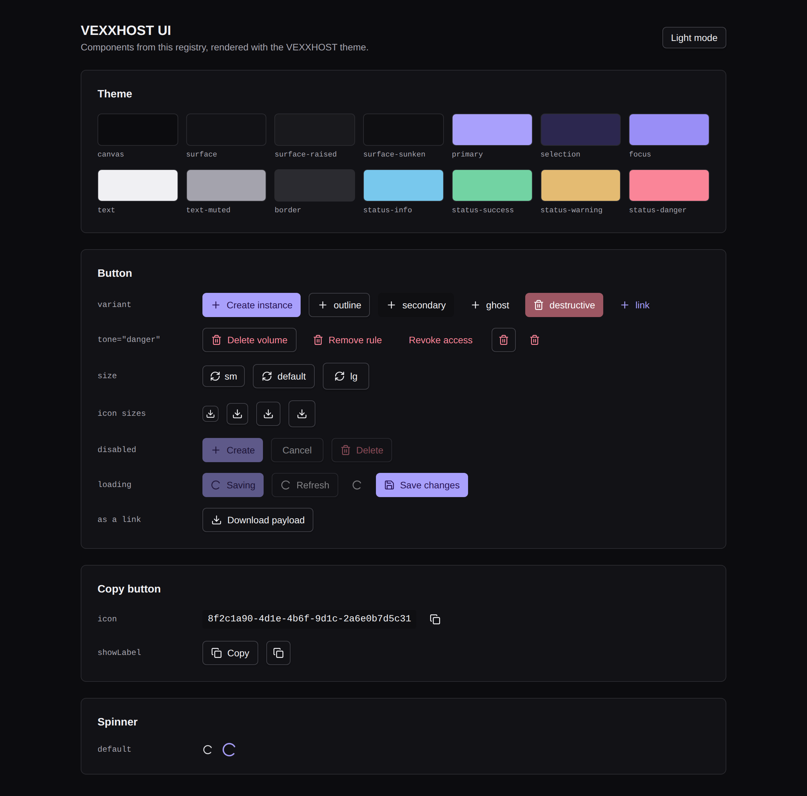

# VEXXHOST UI

Shared React components and the VEXXHOST theme, published as a
[shadcn registry](https://ui.shadcn.com/docs/registry/github). Applications copy
the code into their own repository with the shadcn CLI, so every app builds on
the same components and tokens without depending on a package at runtime.

| Light | Dark |
| --- | --- |
|  |  |

## What is in the registry

| Item | What it installs |
| --- | --- |
| `theme` | VEXXHOST brand tokens for light and dark mode, and their shadcn/ui aliases (`--primary`, `--border`, …), merged into the app's global CSS. |
| `button` | `Button` and `buttonVariants`, built on [Base UI](https://base-ui.com). Variants, a `danger` tone, sizes and a `loading` state. |
| `copy-button` | `CopyButton`, which copies a value and confirms with a check mark. |
| `spinner` | `Spinner`, the loading indicator used by `Button`. |
| `utils` | `cn()`, the class name helper every component uses. |

## Using it in an application

The app needs Tailwind CSS 4 and a `components.json` (run `npx shadcn init` if
it does not have one). Then add the items:

```sh
npx shadcn@latest add vexxhost/ui/theme vexxhost/ui/button vexxhost/ui/copy-button
```

The files land in the app's `components/ui` and `lib` folders and are committed
with the app. To pick up a newer version, run the same command with
`--overwrite`. Name `vexxhost/ui/theme` explicitly: the CLI only replaces
existing token values when the theme itself is requested, not when it arrives
as a dependency of another item.

Do not edit the copied files in the app. Change them here, then sync. Apps can
enforce this in CI by running the sync command and failing on
`git diff --ignore-all-space --exit-code` (the CLI re-indents CSS, so whitespace
is ignored). Sunrise does this with `pnpm ui:sync`.

## How the layers fit

| Layer | Lives in | Holds |
| --- | --- | --- |
| Behaviour | `@base-ui/react` (npm) | Keyboard, focus, disabled state. Never edited. |
| Components | this registry | Variants, sizes, states. Components only reference token names, never colours. |
| Theme | this registry (`theme`) | Colour, radius and shadow values for light and dark mode. |
| Application | the app | Compositions of these components, app-only tokens, extra palettes. |

Rule of thumb: if a change should look the same in every app, it belongs in a
component here; if it is brand, it belongs in a token; if it is specific to one
screen, it stays in the app.

## Button conventions

- `variant="default"` is the primary action. `outline` is the everyday
  secondary button; `ghost` is for toolbars and table rows.
- `tone="danger"` turns `outline`, `ghost` and `link` buttons red for delete and
  remove actions. Solid red is `variant="destructive"`, for the final confirm.
- `loading` replaces the leading icon with a spinner, sets `aria-busy`, and
  disables the button while keeping it focusable.
- Buttons default to `type="button"`. Form submit buttons say `type="submit"`.
- Links that look like buttons put `buttonVariants()` on the `<a>` or router
  `<Link>`, so they keep link semantics.
- Icon-only buttons need an accessible name (`aria-label`).

## The theme

The brand colour is the logo violet `#6536FF`, with the logo ink `#2A1659` for
text on violet surfaces. Light mode uses `#6536FF` for primary actions (5.96:1
against white text); dark mode uses a lighter tint of the same hue with ink text.
Neutrals carry only a trace of the brand hue so screens stay grey rather than
lavender, and status colours (info, success, warning, danger) stay independent
of the brand. Text colours meet WCAG AA on every surface in both modes, and
the gallery is checked with axe in CI.

## Development

```sh
pnpm install
pnpm dev            # gallery at http://localhost:5173
pnpm validate       # shadcn registry validation
pnpm typecheck
pnpm test           # builds the gallery, runs axe and behaviour tests
pnpm screenshots    # refreshes docs/images
```

The gallery renders the registry's own source files with the theme generated
from `registry.json` (`scripts/theme-css.mjs`), so what it shows is what
`shadcn add` installs.

## License

Apache License 2.0.
