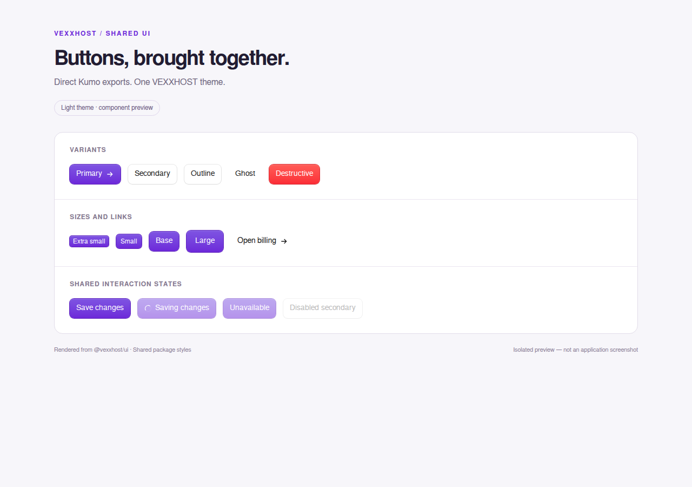

# @vexxhost/ui

Shared VEXXHOST React components, initially backed by Cloudflare Kumo 2.13.2.
Requires React 19. The root Button and LinkButton are direct re-exports: the same implementation, props, types, refs, and defaults as Kumo.

```tsx
import { Button, LinkButton } from "@vexxhost/ui";
// Import once in your application root layout:
import "@vexxhost/ui/styles.css";

<Button variant="primary" type="submit">Save changes</Button>
<LinkButton href="/billing">Billing</LinkButton>
```

Primary actions use VEXXHOST purple (#6d28d9, #7c3aed in dark mode). Kumo's default variant remains secondary; request `variant="primary"` explicitly. Theme overrides and compiled button utilities live in this package. Consumers do not need to scan its node_modules or import Kumo CSS. No Tailwind preflight is included. Dark mode supports `.dark`, `data-theme="dark"`, and `data-mode="dark"` on the document root.

## One component API

All consumers import directly from `@vexxhost/ui`. Use `variant="primary"` for primary actions, `shape="square"` with an accessible name for icon controls, and `LinkButton` for navigation. Forms specify `type="submit"` explicitly; Kumo defaults to `type="button"`.

Configure Kumo's `LinkProvider` once in a client provider to connect `LinkButton` to the application's router. The Website provider uses its localized Next.js Link; the other applications use Next.js Link. There are no legacy Button wrappers or compatibility entry points.

## Development

```sh
npm ci
npx playwright install chromium
npm test
npm pack
```

The browser suite verifies passthrough identity, refs, keyboard activation, disabled/loading states, form submitters, Radix composition, router links, and purple light/dark styling.

## Private upstream and consumer updates

Canonical source: **https://github.com/vexxhost/ui** (private).

The four initial consumers use a vendored package built from an exact commit in this repository. Each consumer records the source repository, full commit, version, artifact name, and SHA-512 integrity in `vendor/ui-source.json`. The commit appears in the artifact filename, so package managers cannot silently reuse a previous build of the same version. Their CI and deployment installs do not require access to this private repository.

To update a consumer, check out the desired UI commit, install dependencies, and run:

```sh
npm ci
npm run link:consumer -- ../website
# Other consumers: ../eventhub, ../onboarding, ../atlas
```

The command requires a clean committed UI checkout, builds and packs this package, copies the artifact, records its source, updates the consumer manifest and lockfile, and removes its previously referenced UI artifact. Review and commit the resulting consumer changes. No registry publication or automatic consumer deployment occurs.

## Screenshots

```sh
npx playwright install chromium
npm run screenshots
# With all four consumer repositories cloned alongside ui:
node scripts/screenshots.mjs --all-apps
```

The screenshots render real shared components in an isolated gallery. Consumer previews compile and apply the corresponding application stylesheet. These are component previews, not authenticated application screenshots. Each preview is captured in light, dark, and mobile layouts, with checks for page errors and horizontal overflow.



This package centralizes imports and theme ownership. Because the public API is currently Kumo's API, switching implementations later means preserving that API or migrating callers; a passthrough does not guarantee a cost-free replacement.
